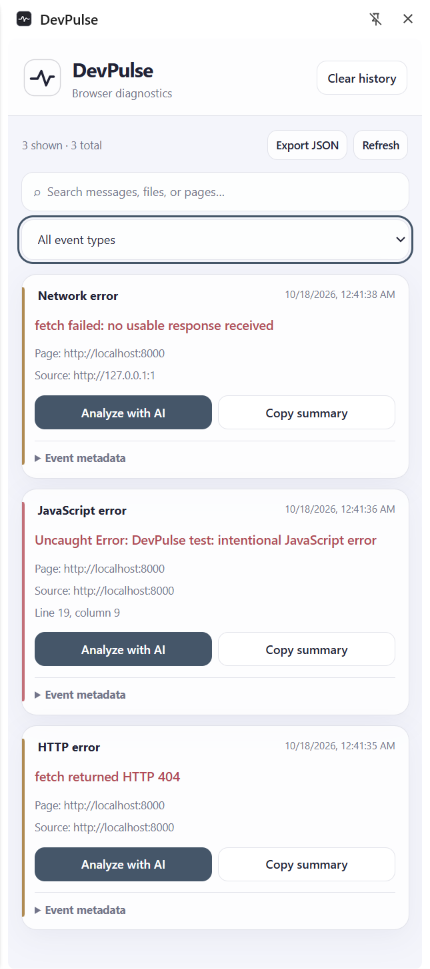
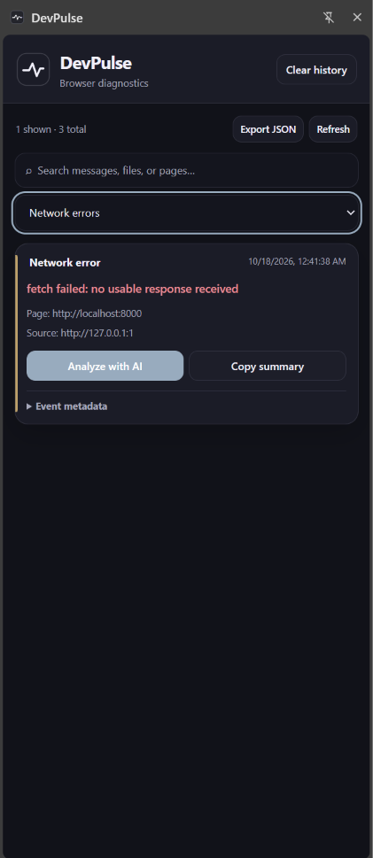
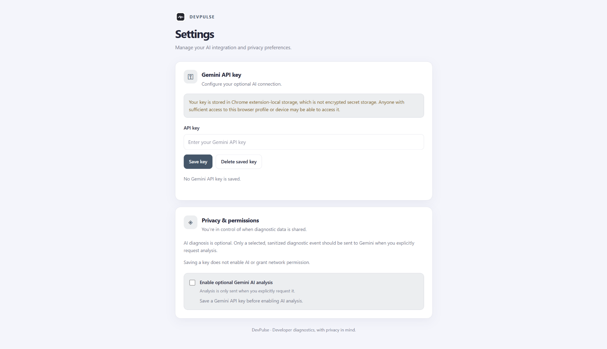

# DevPulse

**A Chrome extension for smarter browser debugging.**

## Problem Statement

Debugging web applications often means switching between the browser console and network tools to find errors, understand failures, and organize diagnostic information. DevPulse aims to bring these signals into one searchable side panel, with optional AI-assisted analysis to help developers investigate issues faster.

## Features

- **Error Monitoring** — Capture supported JavaScript errors and network failures.
- **Search & Filter** — Find events by text and event type.
- **History & Export** — Persist events, copy diagnostic summaries, and export JSON.
- **AI Assistance** — Optionally analyze selected events using Google Gemini.
- **Privacy Controls** — Sanitize diagnostic data and require explicit AI-analysis requests.
- **Light & Dark Themes** — Follow the system appearance.

## Screenshots

 



## Installation

1. Install [Google Chrome](https://www.google.com/chrome/) and [Git](https://git-scm.com/).
2. Clone the repository:

   ```bash
   git clone https://github.com/SarthDange/DevPulse.git
   cd DevPulse
   ```

3. Open `chrome://extensions` in Chrome.
4. Enable **Developer mode**.
5. Click **Load unpacked** and select the DevPulse project folder containing `manifest.json`.

## Local Testing

### Requirements

- **Node.js:** 20 LTS or later recommended.
- **npm:** Installed with Node.js. Check the versions available on your computer before testing.

Open a terminal in the **DevPulse project root**—the folder containing `package.json` if present, `manifest.json`, and the test scripts.

Check your versions:

```bash
node --version
npm --version
```

### Run the test page

1. In the terminal, run:

   ```bash
   npx http-server . -p 8000
   ```

2. If prompted to install `http-server`, review the prompt and confirm if you want to proceed.
3. Keep the terminal open while the server is running.
4. Open `http://localhost:8000/test-page.html` in Chrome.
5. Use the page to trigger test errors and inspect DevPulse.
6. When finished, return to the terminal and press **Ctrl+C** to stop the server.

### Run the automated test scripts

Open a **second terminal** in the same DevPulse project root and run:

```bash
node test-redaction.cjs
node test-gemini-client.cjs
```

Run one command at a time and check its output before proceeding. These scripts test specific components; passing them does not guarantee that every extension feature works correctly.

## Optional: Gemini Setup

1. Create an API key in [Google AI Studio](https://aistudio.google.com/).
2. Open DevPulse Settings and save the key.
3. Enable AI analysis and grant any requested permission.
4. Select a diagnostic event and explicitly request analysis.

**Security note:** The key is stored in `chrome.storage.local`, which is not encrypted secret storage. Never commit or share it. Sanitization is best-effort, and data submitted for AI analysis is sent to Google.

## Documentation

- [Architecture](docs/ARCHITECTURE.md)
- [Event Capture](docs/EVENT_CAPTURE.md)
- [Privacy & Security](docs/PRIVACY_SECURITY.md)
- [AI Integration](docs/AI_INTEGRATION.md)
- [Development Guide](docs/DEVELOPMENT.md)

## Project Status

**Working prototype.** Core features are implemented; broader regression and security testing remain ongoing.

Built with JavaScript and Chrome Extension APIs.
